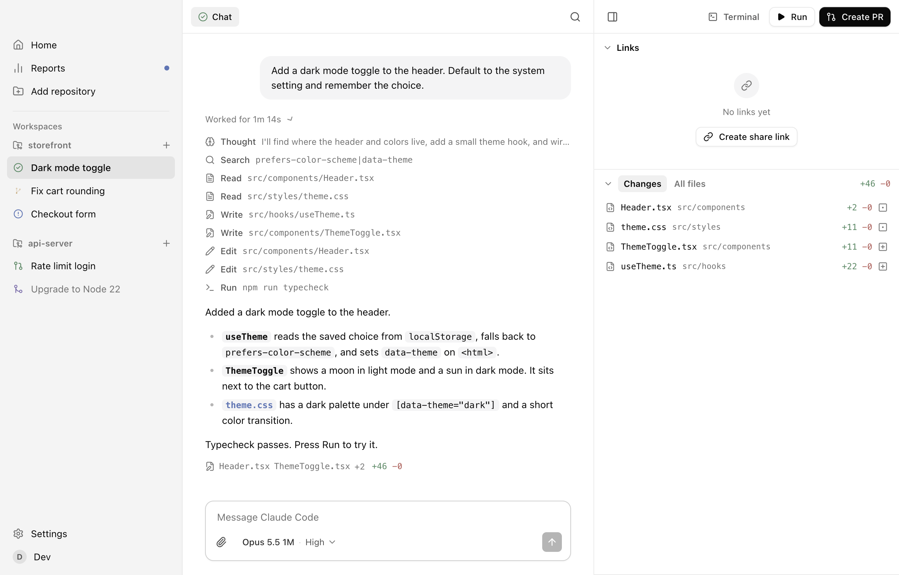
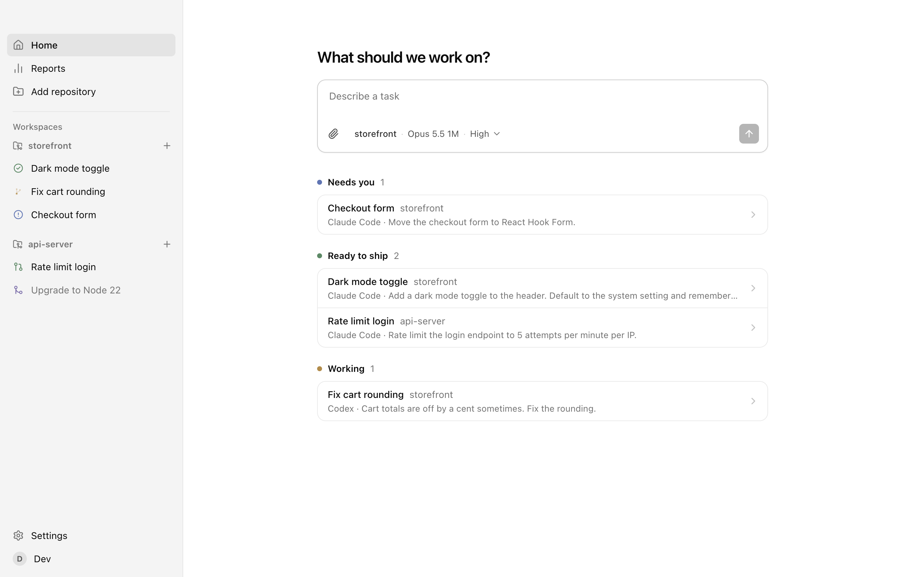

<p align="center">
  
</p>

<h1 align="center">Simpleton</h1>

<p align="center">
  Run Claude Code and Codex in parallel on your Mac or Linux machine.<br>
  Every task gets its own git worktree, a live link and a one-click pull request.
</p>

<p align="center">
  <a href="https://www.simpleton.io">Website</a> ·
  <a href="#install">Download</a> ·
  <a href="docs/architecture.md">Architecture</a>
</p>

<p align="center">
  
</p>

## Features

- **Parallel agents.** Start as many Claude Code and Codex tasks as you like. Each one runs in its own worktree and branch, so they never step on each other.
- **Your own subscriptions.** Simpleton drives the `claude` and `codex` CLIs you already have, so tasks use your Claude and ChatGPT plans. No API keys.
- **One inbox.** Home groups every task into Needs you, Ready to ship and Working. A chime plays when an agent finishes or asks something.
- **Answer from the app.** Agent questions, plans and permission requests show up as cards with buttons.
- **Live preview.** Run starts the dev server on a free port. Every workspace also has its own terminal.
- **Share links.** Turn any running app into a public `*.simpleton.live` link to show a teammate or test on your phone.
- **One-click PRs.** Create PR commits, pushes and opens the pull request with the agent's summary as the description.
- **Review the diff.** See changed files, browse the tree, search and edit files with live git markers.
- **Screenshots.** Agents can screenshot visual changes. Annotate them with arrows, boxes and text before you send them back.
- **Reports.** A heatmap of agent runs and your commits, with short daily and weekly summaries.

<p align="center">
  
</p>

## Install

**macOS** with Homebrew:

```bash
brew install --cask simpleton-io/tap/simpleton
```

Or download the app for [Apple silicon](https://github.com/simpleton-io/releases/releases/latest/download/Simpleton-arm64.dmg) or [Intel](https://github.com/simpleton-io/releases/releases/latest/download/Simpleton-x64.dmg).

**Linux**: [.deb x64](https://github.com/simpleton-io/releases/releases/latest/download/Simpleton-amd64.deb), [.deb arm64](https://github.com/simpleton-io/releases/releases/latest/download/Simpleton-arm64.deb), [AppImage x64](https://github.com/simpleton-io/releases/releases/latest/download/Simpleton-x86_64.AppImage), [AppImage arm64](https://github.com/simpleton-io/releases/releases/latest/download/Simpleton-arm64.AppImage).

The app updates itself.

## Setup

1. Install at least one agent and sign in to it:
   - [Claude Code](https://docs.anthropic.com/en/docs/claude-code): `npm install -g @anthropic-ai/claude-code`, then run `claude` once
   - [Codex](https://github.com/openai/codex): `npm install -g @openai/codex`, then run `codex` once
2. Open Simpleton and sign in with Google.
3. Click **Add repository** and pick a local git repo.
4. Describe a task and press Enter.

Optional: install the [GitHub CLI](https://cli.github.com) and run `gh auth login` so Create PR opens the pull request for you. Without it, Simpleton opens GitHub's new PR page with everything filled in.

## Build from source

Requires Node 22 and git.

```bash
git clone https://github.com/simpleton-io/simpleton-app.git
cd simpleton-app
npm install
SIMPLETON_SKIP_AUTH=1 npm run dev
```

`SIMPLETON_SKIP_AUTH=1` skips sign-in in development builds. Running from the VS Code terminal? Run `unset ELECTRON_RUN_AS_NODE` first.

| Command | What it does |
|---|---|
| `npm run dev` | Start the app with hot reload |
| `npm run typecheck` | Type check main, preload and renderer |
| `npm run dist` | Build a macOS DMG and zip |
| `npm run dist:linux` | Build AppImage and deb packages |

How it works under the hood is in [docs/architecture.md](docs/architecture.md).

## Contributing

Issues and pull requests are welcome. For anything bigger than a small fix, open an issue first so we can agree on the approach.

## License

[MIT](LICENSE)
